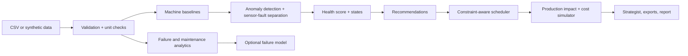

# SENTINEL AI — Predictive Maintenance & Equipment Reliability Intelligence
Detect the signal. Prevent the shutdown.

Analyses machine sensor readings, maintenance history and production schedules to find emerging equipment risks, links them to production exposure and proposes maintenance actions with a constraint-aware schedule. Bundled data is **fictional synthetic data**; there is no live telemetry.

## Architecture


## Run
```
pip install -r requirements.txt
python app.py
```
In Google Colab paste `app.py` into one cell. The `src/` modules in the brief are consolidated into `app.py`.

## Tests, docs, safety
`pip install pytest && pytest tests` runs the built-in self-tests. See `docs/`. Optional LLM: set `ANTHROPIC_API_KEY` (see `.env.example`); off by default. Not included: OR-Tools, RUL, PDF. Decision support only: no maintenance is executed and safety-critical decisions need qualified engineers. Add screenshots to `screenshots/`.
